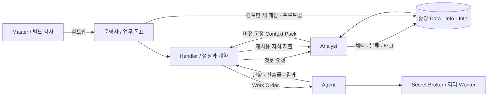

# 에셜론 나노 로컬 베타

기획서의 첫 사용 가능한 베타 범위다. 네 역할, 중앙 지식, 실패 보존, 기본 프로토콜, Vault, 실제 도구 실행과 운영 화면을 연결한다. 실제 계정·브라우저·컨테이너 검증 결과는 [구현 검증표](IMPLEMENTATION.md)에 기록한다.

## 운영 흐름

1. `Initialize-Local.ps1`로 Rust core, PostgreSQL, Vault와 Worker를 준비한다. 기존 설치는 데이터 볼륨과 연결 계정을 유지한다.
2. `Start-Login.ps1`로 ChatGPT 계정을 명시적으로 연결한다. 이미 연결한 계정은 재사용할 수 있다.
3. `Open-Console.ps1` 또는 `http://127.0.0.1:18431/`로 바로 들어간다. 첫 화면의 암호·인증 코드·사용자 로그인은 없으며 접속한 로컬 사용자가 운영자다. CSRF 보호용 HttpOnly 세션은 자동 생성하고, 사용자 로그인 체계는 후속 단계로 둔다. 모델 사용을 위한 ChatGPT OAuth 연결은 별도다.
4. 업무실을 만들고 Central에서 재사용할 자료를 제출·채택한다. 업무실은 중앙 정보와 Task의 접근 경계다.
5. 새 Task에는 업무 목표만 입력하고 ‘Handler에게 맡기기’를 누른다. Handler가 연결 계정의 모델, 호출·토큰 예산, 산출물, 완료·검증 조건, 제약, 도구, 프로토콜과 후처리를 정한다. 계정 연결은 업무실에서 한 번 준비한다.
6. Handler가 Context Pack을 요청하고 Analyst가 기존 정보와 실패를 고른다. Handler가 레퍼런스를 확인한 뒤 도구·URL·기밀 참조·입력 파일을 포함한 계약을 확정하고 Agent에게 고정 계약을 지시한다. 결정한 설정과 계약은 Brief에서 확인한다. 필수 업무 자료가 부족하면 실행 중 추가 입력을 요청할 수 있다.
7. Agent는 자기 Work Order와 허용 입력만 사용한다. 파일 변경은 임시 작업 디렉터리에서 실행하고 결과를 불변 아티팩트로 회수한다. Handler가 결과를 평가하고 필요하면 제한 내에서 재계획하거나 추가 입력을 요청한다.
8. 선택한 후처리에서 Handler가 재사용 지식을 제출하고 Analyst가 채택·반려한다. Master는 별도 감사 단계에서 정리·프로토콜 검토안을 만든다. 업무 결과와 후처리 상태는 각각 보존된다.

## Task와 실행 상태

Task는 목표·계약·계획·입력·산출물·Work Order를 갖는다. 초안, 준비, 실행, 입력 대기, 일시정지, 차단, 완료, 실패, 취소와 보관 상태를 제공한다. 보관해도 중앙 채택 정보와 원래 결과는 삭제되지 않는다. 복제는 입력 파일의 권한을 자동 상속하지 않는 새 Task를 만든다.

실행은 `queued → running → completed`가 기본이며, `paused`, `interrupted`, `cancelled`, `failed`, `exhausted`를 별도로 기록한다. 동시에 두 실행만 처리하고 대기열을 64개로 제한한다. 한 Task에서 활성 실행은 하나다. 새 실행의 Work Order 예산도 기존 Task 발행 수를 포함한다.

일시정지는 현재 제공자 응답 또는 도구 처리 경계에서 적용된다. 취소 후에는 후속 모델 판단과 업무 도구를 시작하지 않는다. 이미 시작한 읽기·샌드박스 작업의 수신 결과는 실행 원장과 아티팩트로 남을 수 있다. 이미 완료한 업무 결과를 후처리 취소로 덮어쓰지 않는다.

서버가 종료되면 실행 중 기록은 `interrupted`가 된다. 자동으로 모델 호출을 반복하지 않으며 운영자가 이어 실행해야 한다. 체크포인트의 모델 결정, 고정 효과 키와 완료 원장을 재사용한다. 같은 효과 ID로 다른 요청을 재생할 수 없다. Worker가 살아 있다면 진행 중·완료 작업의 캐시된 결과를 회수한다. Worker 자체가 재시작된 경우, 현재 어댑터의 관찰용 GET와 임시 파일 작업만 재조정할 수 있다. 외부 변경 어댑터는 별도의 멱등·상태 확인 계약이 있어야 추가할 수 있다.

## 중앙 지식과 외부 모델 전송

Data는 원천·자료 위치, Info는 맥락화한 사실·규칙·경험, Intel은 업무 판단에 사용할 근거다. reference/excerpt/artifact/hybrid 적재를 구분하고 태그와 버전 고정 관계를 남긴다. 큰 기술 문서는 위치·필요 절을 참조하고, 작은 자료는 재조회 비용에 따라 발췌한다.

거짓과 실패는 `truth_state=refuted`, `outcome=failed` 및 조건·시도·관찰·이유·회피·재시도 조건으로 보존한다. `거짓`, `실패` 태그는 상태에 맞춰 서버가 관리한다. 현재 정정된 항목도 관련 과거 실패를 Context Pack에서 제외할 수 없다. 변경은 새 개정이며 이전 본문·태그·분류·출처는 남는다.

선택적 `valid_until`은 UTC Unix 초 단위의 유효기한이다. 기한이 지나면 원래 문서를 변경하지 않고 유효 최신성을 만료로 계산하며, 관련 Context Pack과 프로토콜에 재검토 경고를 보낸다. 시간 경과만으로도 캐시를 무효화한다.

열람 권한과 외부 모델 전송 허용은 구분한다. 전송 금지 Task·문서와 파생 항목은 유효 정책을 전파하고 모델 도구 결과에서 본문·제목을 가린다. 이미 사용한 원천의 정책이 바뀌면 다음 추론 전에 실행을 중단한다. 제한 해제는 자동으로 전파하지 않는다. 이 베타에는 로컬 모델 어댑터가 없으므로 전송 금지 업무는 외부 LLM 실행을 차단한다.

## Master와 프로토콜

Master는 감사·등록 정보·성공한 반복 구조를 읽는다. 동일 목적과 산출물·도구·검증 구조로 완료한 서로 다른 Task가 세 개 이상이면 반복 후보로 제공한다. 운영자가 명시적으로 요청한 수동 프로토콜도 제안할 수 있다.

완전히 같은 본문·상태·출처·관계는 원본 둘을 유지한 채 중복 연결할 수 있다. 의미를 바꾸는 개정·병합·분리, 검증 요청과 프로토콜 변경은 검토안이다. 운영자가 기준 버전과 변경 후 내용을 확인해 적용·반려한다. 새 항목의 사실 검증 상태를 Master의 추론만으로 확정하지 않는다. 검증 요청을 Task로 전환하는 일도 운영자가 수행하며 Master에게 Agent 지시권을 주지 않는다.

프로토콜은 작전명, 설명, 적용 조건, 별칭, 입력 변수, 필수·선택 정보셋, 단계, 완료·중단·재시도 조건, 소유자와 원래 Task를 갖는다. 후보·검증 중·활성·일시중지·폐기를 구분한다. 검토 후 활성화하면 `프로토콜:알파` 같은 태그를 실제 정보 개정에 남기고 그 버전을 고정한다.

프로토콜 실행은 요청·선별·전달을 서버에서 직접 처리하고 필수 정보와 관련·최신·실패 개정을 구성한다. 이 준비 단계에서는 Handler·Analyst LLM 검색을 호출하지 않는다. 절차·완료·중단·재시도 조건·입력과 버전을 Work Order에 고정하고 필수 참조를 빠뜨린 지시는 거부한다. 필수 참조는 최대 16개다. 캐시 키에는 업무실, 프로토콜·정보 개정, 유효 전송 정책·상태·만료 시점이 포함된다. 최신 근거와 의미·상태가 달라지면 재검토 경고를 표시하되 이전 고정 근거를 바꾸지 않는다. 개정 이력의 이전 내용을 복원하려면 현재 버전을 기준으로 새 검토안을 만든다.

## 도구와 기밀

| 도구 | 범위와 결과 |
| --- | --- |
| `external.fetch` | Work Order와 현재 Task 양쪽에서 허용한 정확한 URL의 GET만 실행. DNS 결과를 고정하고 리다이렉트·메타데이터·루프백·core/DB/Vault/Worker 대상은 차단. 내부망·HTTP는 계약에서 별도 지정 |
| `shell.exec` | 승인한 UTF-8 입력 파일, POSIX shell·Python3·git, 상대 출력 경로. UID 10002, 권한 없는 자식, 네트워크 syscall 차단, 1–30초, 메모리·파일·프로세스 한도 |
| `artifact.write/read` | Task/Work Order 범위의 불변 파일, SHA256·형식·크기·출처. 최대 1 MiB, 작업 출력당 128 KiB·합계 512 KiB |
| Secret Broker | Vault의 불투명 ID·용도·정확한 허용 주소·버전. 요청 순간에 인증 헤더를 주입. 비활성화·CAS 회전·버전 일치 검사와 알려진 값·일반 인코딩·민감 JSON 필드 마스킹 |

Worker의 HTTP 제어 프로세스는 내부망의 인증된 RPC만 받는다. core 연결이 끊겨도 독립 supervisor가 기존 작업을 마치고 결과를 보관한다. 같은 키의 재요청은 실행 중 작업을 기다리고 원래 결과를 반환한다. 자식 프로세스에는 제어 토큰·DB·Vault 자격증명·호스트 디렉터리가 전달되지 않는다. 제어 프로세스의 정리 권한은 자식에게 상속되지 않으며 새 권한 취득을 금지한다. 실행 후 자식과 자손을 종료하고 작업 디렉터리를 정리한다. 공유 Linux 커널을 사용하는 로컬 컨테이너 실행이며 상호 불신 다중 사용자 호스팅은 확장 범위다.

아티팩트는 초기 크기 한도에 맞춰 PostgreSQL BYTEA와 기존 데이터 볼륨에 보관한다. DB 트랜잭션·불변 이력·백업을 함께 유지하기 위한 선택이다. 큰 파일·객체 저장소·Office/PDF 처리 어댑터는 별도 확장으로 둔다.

OAuth와 명시적 OpenAI API 키 연결은 Vault에서 관리한다. API 키 계정은 업무실에서 직접 선택해야 하며 OAuth 오류 시 자동 대체하지 않는다. 실계정 없는 API 키 어댑터의 구현·검사는 실제 API 키 추론 성공과 구분한다.

## 관찰과 UI

Path는 현재 Task의 Work Order·고정 정보 ID/버전·결과를 연결한다. Broadcast는 역할, 도구, 성공·거부·오류와 토큰 수를 보여 준다. 비공개 reasoning 원문을 이벤트에 쓰지 않는다. SSE는 DB 순번과 `Last-Event-ID`로 재연결하며 매번 세션과 업무실·Task 범위를 검사한다.

설정에서 계정 카탈로그, 사용 모델, 관찰 토큰과 토큰 갱신을 관리한다. 사용량은 완료 응답의 수치이며 잔여 계정 한도나 비용을 추정하지 않는다. 배경·레이아웃·상태 색은 고정하며 포인트 색 하나만 바꿀 수 있다. 본문 대비가 부족한 색은 밝기를 보정한다.

## 주요 운영자 API

운영자 경로는 Bearer 또는 자동 발급한 로컬 브라우저 세션을 사용한다. `POST /v1/ui/session`은 로컬 Host와 동일 출처에서 암호·코드 없이 세션을 연다. 이는 사용자 인증 체계가 아니므로 현재 배포는 localhost의 개인 운영을 전제로 한다. 역할의 직접 도구 API는 계속 서명된 역할·Task·Work Order 토큰을 요구한다. `/v1/operator/domain`도 호출자가 역할을 정하지 않고 서버가 도구에 맞는 고정 역할을 선택한다.

명시적으로 신뢰한 내부망에서 사용할 때는 비공개 `compose.override.yaml`에 필요한 호스트 IP의 포트 바인딩과 `ECHELON_UI_ORIGINS`를 추가한다. 원점은 쉼표로 구분한 정확한 `http(s)://주소:포트`이며 와일드카드·경로·인증정보는 허용하지 않는다. 요청의 Origin과 Host도 일치해야 한다. 방화벽은 해당 호스트 주소와 승인한 클라이언트 대역으로 제한한다. 이 설정은 로그인 기능을 추가하지 않으며 접속자는 운영자다. OAuth 연결의 loopback callback은 유지한다.

| 경로 | 용도 |
| --- | --- |
| `GET/POST /v1/operator/tenants` | 업무실 목록·생성 |
| `POST /v1/operator/tenants/{id}/workspace` | 중복 없는 관리용 Task 준비 |
| `GET/POST /v1/operator/tasks` | 검색·보관 필터·Task 생성 |
| `GET/PATCH /v1/operator/tasks/{id}` | 계약·상태·산출물·지시·실행·도구 원장 |
| `POST /v1/operator/tasks/{id}/inputs` | 보충 입력과 질문 답변 |
| `POST /v1/operator/runs` | 실제 모델 실행 시작 |
| `POST /v1/operator/runs/{id}/control` | `action: pause/resume/cancel` |
| `POST /v1/operator/artifacts` | `tenant_id,task_id,artifact:{request_id,name,content 또는 data_base64}` |
| `GET /v1/operator/artifacts/{id}/download` | 업무실 범위의 첨부 다운로드 |
| `GET /v1/operator/protocols`, `/{id}` | 설명·고정 버전·재검토·캐시 상태 |
| `GET /v1/operator/maintenance` | 정리·프로토콜 검토안 |
| `POST /v1/operator/maintenance/decide` | 기준 버전 검사 후 적용·반려·활성화 |
| `GET /v1/operator/reviews`, `POST /reviews/{id}/task` | 별도 검증 요청의 Task 전환 |
| `GET/POST /v1/operator/secrets` | 기밀 메타데이터·등록·회전 |
| `GET /v1/operator/events` | 업무실 및 선택한 Task의 SSE |

실행 추가 옵션은 `retain_knowledge`, `dream_after`, `mode:work/dream`, `protocol_id/version`, `parameters`다. 감사 실행은 별도 dream/administration Task에서만 시작한다. 운영자가 이미 전달한 같은 Task의 `prepared_pack_id`와 선택적 `eager_context`는 사전 검토 및 전체 컨텍스트 비교 실험용이다. 일반 실행은 이 옵션을 사용하지 않는다. 모든 사전 로드에도 범위·전송 정책과 128 KiB 예산을 적용한다.

## 검증과 성능 해석

`Verify-Beta.ps1`는 실제 Vault·HTTP·Worker·브라우저 세션 경계를 검사한다. `Verify-WorkScenarios.ps1`는 실제 OAuth로 보고서·코드 변경·업무 요청 분류와 후처리·Master·프로토콜 재사용을 수행한다. `Verify-Recovery.ps1`는 별도 합성 Task의 core를 중단하고 같은 Work Order·Worker 작업·산출물과 SSE 순번의 복구를 확인한다.

성능 비교는 같은 모델·목표·API 입력·완료 조건에서 Handler/Agent 전체 정보 주입, Analyst 선별, 프로토콜 직접 로드를 각각 실행한다. 단일 합성 표본의 입력·출력·지연·정확성 결과이며 25% 절감은 목표다. Master의 프로토콜 준비·감사 비용을 별도 합산하고 1·5·10회 재사용으로 나눠 표시한다. 개발 중 실패·재시도와 최종 통제 실험의 비용도 구분해 남긴다. 실제 회사 업무 전체의 절감률로 일반화하지 않는다.

DB·아티팩트 백업과 Vault 암호화 저장소는 분리하며 unseal/복구 자료를 같은 백업에 넣지 않는다. 검증 자료·자격증명·DPAPI 파일은 `.runtime` 아래의 제한된 비공개 파일로 유지한다. 이전 기술 검증 수치는 각 Phase 문서에 남기고 최신 완료 판정은 구현 검증표를 따른다.

`./scripts/Backup-Local.ps1 -VerifyRestore`는 활성 실행이 없을 때 core와 Vault 쓰기를 멈추고 별도 저장소 백업을 만든다. 비어 있는 전용 검증 DB에 복원해 지식·산출물·실행 수를 비교한 뒤 기존 스택을 다시 시작한다. 실행 중인 검증 스택은 덮어쓰지 않는다. Vault 저장소 아카이브 검사와 실제 Vault 재해 복구는 구분하며, unseal 자료의 독립된 보호·보관은 운영자에게 필요하다.
