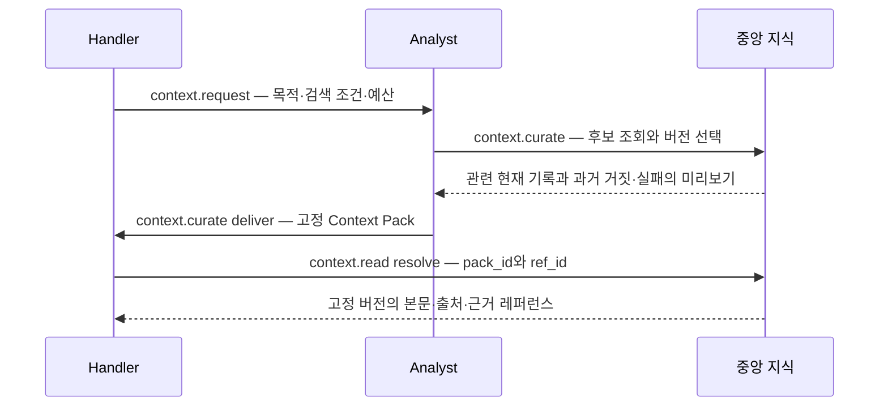

# Analyst → Handler Context Pack

Handler가 필요한 정보의 범위를 요청하면 Analyst가 중앙 지식 후보를 조회하고 근거 버전을 선택한다. 전달 시 고정된 Pack과 레퍼런스를 저장한다. Handler는 자기 Task에 전달된 Pack의 레퍼런스를 통해 해당 버전의 지식과 연결된 근거·실패 이력을 읽는다.



## 요청과 선별

`context.request`는 Handler만 호출한다. need, query 또는 tags, 선택적 categories·constraints와 조회 예산을 criteria에 담는다. 등록 당시 Task 목표도 별도로 고정한다. 중앙 본문이나 검색 결과는 요청을 만드는 것만으로 Handler에 노출되지 않는다.

Analyst는 `context.curate`로 요청 대기열과 후보를 읽는다. query는 공백으로 구분한 최대 8개 리터럴 검색어이며 하나 이상 일치하는 기록을 찾는다. 제목 일치에 본문 일치보다 높은 점수를 준다. tags는 모두 일치해야 하고, categories를 지정하면 해당 범주를 선택한다. 현재 개정과 과거 refuted·failed 개정을 함께 검색하며 제목·본문·적용 조건·실패 조건과 관찰을 사용한다. `%`·`_`는 와일드카드로 해석하지 않는다.

후보에는 ID·버전·상태 미리보기와 점수만 담는다. Analyst는 기존 knowledge.read로 필요한 기록을 검토하고 selections에 item_id·version·선택 이유를 지정한다. 명시적 ID 선택은 검색 조건 밖의 관련 근거를 추가할 수 있다. gaps에는 필요한 자료가 없거나 아직 검증되지 않은 범위를 남긴다. 새 업무 사실·본문·요약을 생성하는 필드는 제공하지 않는다.

이 단계는 역할 API와 코드 기반 검색을 구현한다. Analyst의 실제 LLM 호출과 역할 간 자동 스케줄링은 후속 단계다. 검색 품질이나 토큰 절감률을 측정 완료한 것으로 표현하지 않는다.

## 자동으로 포함하는 근거와 주의사항

전달 시 선택한 버전에서 다음을 포함해 참조 집합을 구성한다.

- 선택한 버전의 모든 관계 대상과 그 대상의 근거를 재귀적으로 포함한다.
- 같은 항목의 이전 refuted·failed 개정을 포함한다. 검색 조건과 맞는 별도 거짓·실패 기록도 포함한다.
- 포함된 항목의 전달 당시 현재 버전도 고정해, 오래된 선택과 비교할 수 있게 한다.
- 현재 등록된 역방향 contradicts 관계를 찾아 반대 근거를 포함한다.

상충 관계의 양 끝, 반증·실패·최신성 경고가 있는 기록, 더 새 버전이 존재하는 선택은 cautions로 구분한다. 다른 내용은 knowledge에 둔다. 같은 항목이라도 버전이 다르면 별도의 레퍼런스다. 반대 주장이나 실패가 있다는 이유로 연결된 정보의 진위를 자동 변경하지 않는다.

원본 body·assessment 전문·출처 URI는 Pack 본문에 일괄 복사하지 않는다. 각 헤더에는 ref_id, item_id, version, 고정 문서의 SHA-256, 제목·상태·적용 조건의 짧은 발췌, 선택 이유와 경고 코드를 담는다. 발췌가 잘린 경우 표시한다. 실제 내용과 거짓·실패의 적용 조건·근거·피할 행동·재시도 조건은 해당 레퍼런스를 resolve해 읽는다.

## 고정 버전과 접근 범위

Context Pack은 tenant·대상 Task·요청에 묶인다. Handler의 중앙 knowledge.read는 계속 금지하며, context.read에서 자기 Task의 Pack과 그 안에 등록된 ref_id만 조회한다. 같은 회사의 다른 Task, 다른 회사, 다른 Pack의 레퍼런스, 임의 ID는 404다. resolve에 item_id나 원하는 version을 추가해 범위를 바꾸는 요청도 허용하지 않는다.

resolve는 고정된 개정과 문서 해시를 검사하고 본문·출처·출처 Task·제출 ID를 반환한다. 문서의 관계를 따라갈 수 있도록 links에 같은 Pack 안의 근거 ref_id를 제공한다. ref_id 자체가 인증 수단은 아니며 매 호출에 서명된 Handler 토큰과 Task 범위 검사가 필요하다.

전달 후 중앙 원천이 갱신되어도 Pack과 문서 본문을 새 버전으로 바꾸지 않는다. resolve의 live_notice에 현재 버전·상태와 재요청 권고를 별도로 반환한다. 새 본문을 쓰려면 새 요청과 Analyst 전달을 거친다. 이력 조회와 현재 상태 알림을 혼동하지 않는다.

Analyst는 context.curate의 pack 조회로 같은 tenant의 전달 기록을 다시 볼 수 있다. Handler의 전달 내용과 달리 Analyst 관리 조회는 tenant 안의 여러 Task를 포함한다. 프로젝트·사용자별 ACL은 기존 Phase 1과 마찬가지로 후속 작업이다.

외부 URI를 등록한 Data를 resolve하면 중앙에 저장된 위치를 읽는다. 서버가 외부 문서를 가져오는 기능은 포함하지 않는다.

## API 계약

기존 `POST /v1/tools/invoke`의 tenant_id·task_id는 호출자의 토큰 범위와 일치해야 한다.

| 도구 | 역할 | input |
| --- | --- | --- |
| context.request | Handler | request_id와 criteria |
| context.curate | Analyst | `op=queue`, status·after_id·limit 선택 |
| context.curate | Analyst | `op=request`, request_id |
| context.curate | Analyst | `op=candidates`, request_id, offset·limit 선택 |
| context.curate | Analyst | `op=deliver`, request_id, selections, gaps |
| context.curate | Analyst | `op=pack`, pack_id |
| context.read | Handler | `op=requests`, after_id·limit 선택 |
| context.read | Handler | `op=request`, request_id |
| context.read | Handler | `op=pack`, pack_id |
| context.read | Handler | `op=resolve`, pack_id, ref_id |

요청 예:

```json
{
  "request_id": "<client request UUID>",
  "criteria": {
    "need": "월간 운영 보고서에 필요한 근거와 실패 경험",
    "tags": ["업무:운영보고"],
    "query": "운영 보고",
    "constraints": ["확인되지 않은 수치를 확정하지 않음"],
    "max_references": 64,
    "max_manifest_bytes": 32768
  }
}
```

전달과 참조 예:

```json
{
  "op": "deliver",
  "request_id": "<stored context request UUID>",
  "selections": [{"item_id": "<knowledge UUID>", "version": 3, "reason": "등록된 집계 규칙과 근거"}],
  "gaps": ["이번 달 자료는 Agent의 재확인이 필요함"]
}
```

```json
{"op": "resolve", "pack_id": "<delivered pack UUID>", "ref_id": "<reference UUID from that pack>"}
```

request_id는 Handler 요청에서는 Task 안의 클라이언트 멱등 키이고, curate/read에서는 서버가 반환한 request.id다. 같은 키로 같은 정규화 조건을 보내면 기존 요청을 반환한다. 조건을 바꾸면 409다. 같은 전달의 재전송과 동시 재전송은 기존 Pack을 반환하며 참조 ID를 다시 만들지 않는다. 이미 전달한 요청의 selections·gaps를 바꾸면 409다. 재선별은 새 Handler 요청을 사용한다.

선택은 최대 16개, 참조는 기본 64·최대 128개, manifest는 기본 32,768·최대 65,536 UTF-8 바이트다. 예산은 토큰 수 추정치가 아니다. 근거나 부정 이력까지 포함해 예산을 넘으면 409 `context_reference_budget_exceeded` 또는 `context_manifest_budget_exceeded`를 반환한다. 참조를 조용히 제외하거나 부분 Pack을 저장하지 않는다. 요청은 pending으로 남는다. 이력이 매우 큰 항목은 현재 상한 안에서 전달할 수 없을 수 있다.

신규 Pack·참조·요청 상태 변경·감사 이벤트는 한 트랜잭션에 넣는다. 요청 행 잠금으로 중복 전달을 막고 기존 지식 쓰기와 같은 tenant 잠금으로 선별 중의 근거·현재 버전이 일관되게 보이도록 한다. Pack과 참조는 변경·삭제·TRUNCATE를 거부한다. DB 관리자까지 막는 외부 불변 저장소는 아니다.

## 검증

```powershell
docker compose -f compose.verify.yaml up --build --abort-on-container-exit --exit-code-from tests
docker compose -f compose.verify.yaml down --remove-orphans
./scripts/Verify-ContextPacks.ps1 -RestartCore
```

분리된 PostgreSQL 검증에는 원천 갱신 후 버전 유지, 실패 이력·반대 근거 포함, 한국어·리터럴 검색, 범위 제한, 동시 전달, 예산 초과 원자성, 이력 변경 거부를 포함한다. 실제 HTTP 검증은 서명된 역할 토큰으로 같은 흐름과 서버 재시작 후 Pack·레퍼런스 보존을 확인한다. 결과와 합성 기록의 식별자는 `.runtime/evidence/context-*.json`에 보관한다.

2026년 10월 19일 로컬 결과:

- rustfmt·Clippy `-D warnings`, 단위 테스트 13개, RSA/JWKS 통합 테스트 1개 통과.
- PostgreSQL 통합 시나리오 2개 통과. 기존 중앙 지식과 Context Pack 흐름을 별도 합성 tenant로 검증했다.
- 실제 Context Pack API assertion 51개 통과. 한국어 검색·과거 실패·반대 근거·버전 고정·다른 Task 및 tenant의 접근 거부·중복 전달·예산 초과 원자성·재시작 복구를 포함한다.
- 기존 중앙 지식 API assertion 35개, 네 역할과 17개 기능의 권한 검사 68건, 금지된 실제 dispatch 거부 52건 통과.

GitHub Actions도 동일한 Rust 검사와 PostgreSQL 통합 시나리오를 실행한다. 로컬 실제 HTTP 결과와 CI 결과는 별도로 확인한다.

로컬 DB를 private dump로 백업한 뒤 추가 마이그레이션을 적용했다. 외부 업무 자료나 자격증명을 검증 데이터로 사용하지 않는다. 합성 Task와 지식·Pack은 별도 tenant에 보존하며 검증 컨테이너와 네트워크는 종료 후 제거한다.
