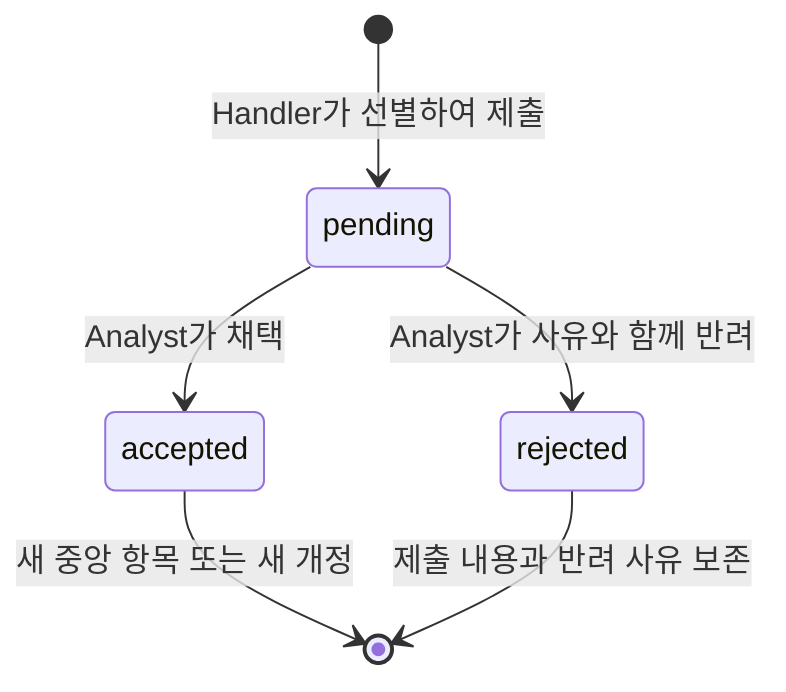

# 중앙 지식 API와 Phase 1 검증

이 문서는 Phase 1 중앙 지식 API와 검증 기록이다. 후속 Analyst→Handler 전달은 [Context Pack 문서](CONTEXT_PACKS.md)를 따른다.

중앙 지식은 tenant 안에서 여러 Task가 공유한다. 고정 ID인 `knowledge_items`와 변경 불가 스냅샷인 `knowledge_revisions`를 분리했다. 태그와 참조도 개정별로 보관한다. Task는 출처이며 중앙 항목의 수명과 동일하지 않다.

## 저장과 분류

| 필드 | 값과 의미 |
| --- | --- |
| category | `data` 원천·위치, `info` 정리된 사실·규칙·경험, `intel` 업무적 판단 |
| storage_mode | `reference`, `excerpt`, `artifact`, `hybrid` |
| truth_state | `unverified`, `supported`, `refuted`, `conflicted` |
| outcome | `not_applicable`, `success`, `failed`, `partial`, `blocked` |
| freshness | `current`, `review_needed`, `expired`, `superseded` |
| sources | URI, 절·위치인 locator, 짧은 note |
| relations | 관계 종류, 대상 고정 ID, 고정 버전 |
| applicability | 해당 정보가 적용되는 조건 |
| assessment | 거짓·실패의 조건, 시도, 관찰, 판정 근거, 피할 행동, 재시도 조건 |

`reference`는 제목과 출처만으로 등록할 수 있으며 본문을 복제하지 않는다. `excerpt`는 짧은 본문과 출처 또는 기존 중앙 지식의 근거 관계를 요구한다. `hybrid`는 본문과 출처를 함께 사용한다. `artifact`는 `artifact://` 위치를 보관하는 계약이며 파일 업로드·다운로드 어댑터는 아직 없다.

외부 URI는 저장만 하며 Analyst나 서버가 접속하지 않는다. HTTP(S)·artifact 위치를 허용하고 URI 사용자명·암호 및 명백한 자격증명 쿼리 필드는 거부한다. 이 검사는 일반 본문의 비밀정보를 모두 찾아내는 DLP가 아니다. 실제 자격증명은 기존 Vault 경로로 관리한다.

제목 240바이트, 본문 16,000바이트, 출처 12개, 관계 32개, 사용자 태그 32개를 제한한다. 태그는 앞뒤 공백을 제거하고 중복을 합치며 대소문자는 보존한다. 진위·결과에서 파생되는 `거짓`·`실패` 태그를 서버가 관리하므로 최종 태그는 최대 34개다.

## Handler 제출과 Analyst 채택



Handler의 제출은 중앙 검색에 나타나지 않는다. Analyst가 대기열에서 제출물을 읽고 채택할 때만 중앙 항목이나 새 개정을 만든다. 반려는 최종 결정이며 수정한 후보를 다시 제출하려면 새 request_id를 사용한다.

Analyst는 채택 시 category·tags를 조정할 수 있다. 본문·출처·관계·진위·결과를 새로 작성하거나 바꾸는 채택 요청은 허용하지 않는다. 채택 이후 `knowledge.classify`도 분류·태그만 변경하며 새 개정을 만든다. 업무 내용이나 진위·결과를 고치려면 Handler의 새 제출과 Analyst의 채택을 다시 거친다.

제출의 `request_id`는 tenant·출처 Task 안에서 멱등 키다. 같은 키·같은 정규화 내용은 기존 제출을 반환하고, 다른 내용은 409를 반환한다. 같은 채택·반려 요청의 재전송도 개정을 중복 생성하지 않는다. 이미 결정한 제출에 다른 결정을 보내면 409다.

기존 항목을 수정할 때는 target_id와 base_version을 함께 제출한다. 채택 시 현재 버전과 다시 비교한다. 같은 버전을 기준으로 두 Task가 제출해도 먼저 채택된 한 건만 반영되고 다른 요청은 409로 남는다. 무시하거나 덮어쓰지 않으며 충돌한 제출은 pending으로 남아 검토할 수 있다.

쓰기 트랜잭션에는 개정·태그·관계·제출 결정·감사 이벤트를 함께 넣는다. tenant별 advisory lock으로 그래프 변경을 직렬화하고 항목 버전으로 충돌을 검출한다.

## 도구 계약

모든 호출은 `POST /v1/tools/invoke`에서 서명된 역할 토큰과 다음 봉투를 사용한다. tenant_id·task_id는 호출 토큰의 범위와 일치해야 한다.

```json
{
  "tool": "knowledge.submit",
  "tenant_id": "<tenant UUID>",
  "task_id": "<calling Task UUID>",
  "input": {
    "op": "submit",
    "request_id": "<unique request UUID>",
    "rationale": "재사용할 공식 문서의 정확한 위치",
    "document": {
      "category": "data",
      "title": "가상 시스템 사용 설명서",
      "storage_mode": "reference",
      "tags": ["시스템:예시"],
      "sources": [{"uri": "https://example.com/manual", "locator": "설정 절"}]
    }
  }
}
```

| 도구 | 호출 역할 | input |
| --- | --- | --- |
| knowledge.submit | Handler | `op=submit`, request_id, document, rationale. 개정은 target_id·base_version 추가 |
| knowledge.submit | Handler | `op=status`, submission_id. 자기 Task가 제출한 내용·처리 상태만 조회 |
| knowledge.publish | Analyst | submission_id, decision=`accept` 또는 `reject`, reason. 채택 시 category·tags 선택 가능 |
| knowledge.classify | Analyst | item_id, expected_version, reason, category 또는 tags |
| knowledge.read | Analyst·Master | `op=list`, category·tags·query·negative_history·after_id·limit 선택 |
| knowledge.read | Analyst·Master | `op=get`, item_id, version 선택. 없으면 현재 버전 |
| knowledge.read | Analyst·Master | `op=history`, item_id, before_version·limit 선택 |
| knowledge.read | Analyst·Master | `op=submissions`, status·source_task_id·after_id·limit 선택 |
| knowledge.read | Analyst·Master | `op=submission`, submission_id |

읽기 input `{}`는 기존 Phase 0 호출과 호환되도록 list로 해석한다. 목록은 본문 전문 대신 제목·분류·태그·상태와 실패 이력 존재 여부를 반환한다. limit은 기본 30, 최대 100이며 ID와 버전으로 다음 페이지를 조회한다. query는 제목·현재 본문의 문자 검색이며 `%`와 `_`를 와일드카드로 해석하지 않는다. 태그는 모두 일치해야 한다.

submissions 대기열도 제목·태그·재사용 이유·상태·시각의 요약을 반환한다. 선택한 제출은 submission으로 상세 조회한다. 대기 중인 본문 전체를 기본 목록에 포함하지 않는다.

Analyst의 중앙 조회와 제출 대기열은 같은 tenant의 다른 Task도 포함한다. Handler는 중앙 직접 조회·채택 권한이 없고 자기 Task의 제출만 조회한다. 다른 tenant의 항목·제출 조회는 404, 외부 tenant나 없는 버전에 대한 관계는 같은 오류로 거부한다. 회사 내 프로젝트·사용자 단위 ACL은 후속 작업이다.

## 관계와 검토 경고

관계는 `references`, `derived_from`, `supports`, `contradicts`, `depends_on`, `supersedes`를 지원한다. 대상은 이미 채택된 같은 tenant의 특정 버전이어야 한다. DB 외래키도 이를 검사한다. `depends_on`의 항목 순환은 거부한다. 이전 버전을 참조하는 일반 관계는 보존한다.

get은 references·derived_from·depends_on을 재귀적으로 읽고 고정 버전과 현재 원천의 버전·진위·결과·최신성을 비교한다. 원천 변경·반증·실패·만료는 `dependency_warnings`로 반환한다. 연결된 판단을 자동으로 거짓으로 바꾸지 않는다. supports·contradicts는 별도 주장 관계로 보존하며 그 자체로 진위를 확정하지 않는다.

경고와 부정 이력 요약은 각각 최대 100건이며 더 있으면 해당 `*_truncated` 필드를 반환한다. 개정 전문은 history 페이지나 고정 버전 get으로 계속 읽을 수 있다.

## 거짓·실패와 이력 보존

반증된 정보에는 거짓 태그, 실패한 실행에는 실패 태그를 파생한다. 실패가 곧 거짓이라는 뜻은 아니다. `refuted` 또는 `failed`를 제출하면 assessment의 적용 조건·관찰·근거·피할 행동·재시도 조건을 요구하고, 실패는 시도한 행동도 요구한다.

후속 근거로 supported·success가 되어도 이전 개정의 본문·판정·태그·출처·관계·assessment가 남는다. 현재 태그는 현재 상태와 일치한다. list의 has_negative_history와 negative_history 필터, get의 negative_history 요약을 통해 과거의 거짓·실패를 계속 찾을 수 있다.

API에는 삭제 동작이 없다. DB 트리거는 개정·태그·관계의 UPDATE/DELETE/TRUNCATE, 항목·제출의 DELETE/TRUNCATE를 거부하고 제출의 원문을 변경하지 못하게 한다. DB 관리자까지 제약하는 외부 불변 저장소를 구현한 것은 아니다.

## 2026년 10월 19일 검증

- Rust: rustfmt, Clippy `-D warnings`, 단위 테스트 11개, RSA/JWKS 통합 테스트 1개 통과.
- 분리된 PostgreSQL: 제출과 결정의 멱등성, 실제 트랜잭션과 동시 버전 충돌, 버전 참조·부정 이력, 반려 보존, tenant 분리, 순환 거부, 이력 변경·삭제·TRUNCATE 거부 시나리오 통과.
- 로컬 실제 HTTP: `Verify-Knowledge.ps1 -RestartCore`의 35개 assertion 통과. JWT 역할 제한, 다른 Task에서의 중앙 재사용, 분류·태그·한국어 검색, 대기열 요약, 파생 경고, 실패 보존, 동시 채택, 서버 재시작 후 5개 개정 보존을 확인했다.

기존 DB를 private dump로 백업한 뒤 추가 마이그레이션을 적용했다. 별도 검증 DB와 네트워크는 종료·제거했고, 로컬 API 검증에서 만든 합성 tenant와 기록은 삭제하지 않았다. 식별자와 결과는 `.runtime/evidence/knowledge*.json`에 보관한다. 공개 문서에는 실제 업무 내용이나 자격증명을 포함하지 않는다.

Task 종료와 제출의 자동 연결, Analyst의 LLM 선별, Handler Context Pack, Master 최적화, 프로토콜 및 전체 웹 UI는 이 단계의 구현 범위 밖이다. 이번 단계는 해당 역할 계약과 수동·코드 기반 호출을 위한 영속 API를 제공한다.
