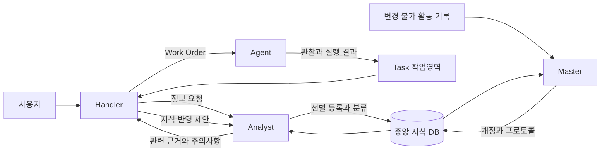
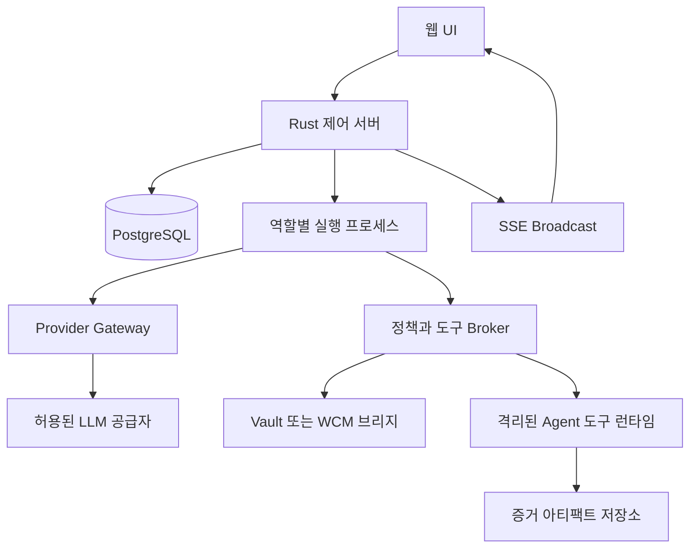

# 에셜론 나노 업무 에이전트 시스템 기획 초안

초안 0.1 · 2026년 10월 19일

에셜론 나노는 여러 회사 업무를 처리하면서 검증된 지식과 실패 경험을 축적하는 업무 에이전트 시스템이다. 중앙 정보 저장소를 Analyst가 관리하고, Handler가 업무를 판단하며, Agent가 실행한다. Master는 이들의 기록을 감사하고 반복 업무를 프로토콜로 정리한다.

첫 버전은 한 사람이 한 회사의 여러 Task를 운영하는 Docker 기반 로컬 설치를 기준으로 한다. 정보에는 처음부터 회사·프로젝트·사용자별 열람 범위를 붙여 향후 협업으로 확장한다. 이 초안은 제품 동작과 설계 기준을 정하며, 실행 프로그램 구현과 실제 계정 연결은 다음 단계에서 진행한다.

## 제품의 목적과 설계 원칙

사용자는 업무 목표와 필요한 제약을 전달하고, 시스템은 필요한 지식만 불러와 업무를 수행한다. Task가 길어져도 대화 전문을 계속 누적하는 대신 목표, 계획, 증거, 미해결 사항, 산출물을 구조화해 유지한다. 다음 업무는 앞선 대화를 다시 읽지 않고 선별된 지식과 프로토콜을 활용한다.

설계의 기준은 다음과 같다.

- 중앙 지식은 Task와 독립된 ID와 수명을 가진다. 출처인 Task는 이력으로 연결한다.
- 진행 중인 관찰과 임시 판단은 Task 작업영역에 둔다. 업무 종료 시 재사용 가치가 있는 내용만 중앙 지식으로 채택한다.
- 원문을 많이 복제하는 것보다 다시 찾아갈 수 있는 정확한 위치와 필요한 짧은 내용에 집중한다.
- 정보 범주, 진위, 실행 결과, 유효성, 기밀등급을 서로 다른 속성으로 관리한다.
- 거짓과 실패도 근거·적용 조건·재시도 조건과 함께 보존한다.
- 역할 제한은 프롬프트와 함께 도구 권한, 서버 검증, 실행 환경으로 강제한다.
- 네 역할은 논리적 역할이다. 매번 네 개의 LLM 세션을 동시에 유지하지 않는다.

Analyst 분리만으로 토큰 절약이 보장되지는 않는다. 검색과 분류를 매 행동마다 LLM에 맡기면 비용이 늘 수 있으므로, 정확한 태그 조회·프로토콜 조회·캐시 적중은 일반 코드로 처리하고 모호한 선택에만 LLM을 호출한다.

## Artex에서 계승할 구조

참조한 Artex 버전에서는 자산 그래프를 공유하고, goal·intent·fact·finding·hint로 구성된 탐색 그래프를 Task별로 유지한다. Planner는 탐색 상황을 읽어 Intent를 만들고 Worker는 Intent를 수행한다. 에셜론 나노는 이 실행 구조와 Path·Broadcast의 관찰 방식을 일반 업무로 확장한다. [Artex 참조 소스](https://github.com/jiwoochris/artex-global/blob/869a4aefc2e6aeee9575e841d3331d6ac93367e7/README.ko.md)

| Artex에서 참고할 요소 | 에셜론 나노의 설계 |
| --- | --- |
| Task와 목표 | 업무 목표, 범위, 완료 조건, 산출물 계약 |
| Planner와 Worker | Analyst·Handler·Agent의 분리와 Master 감사 |
| Task별 탐색 정보 | 중앙 지식과 Task 작업영역의 연결 |
| Fact와 Finding | 범용 Data·Info·Intel 및 별도 검증 상태 |
| Intent | 실행 단위인 Work Order와 Task 계획 |
| Path | 업무 실행 경로와 정보의 근거 경로 |
| Broadcast | Path의 업무 기록을 시간순으로 탐색 |
| Sessions | 역할별 지시·공개 응답·도구 실행·오류와 사용량 |

Intent와 Finding을 이름만 바꿔 지식 범주에 넣지는 않는다. 실행 의도는 Work Order로 관리하고, 결과에서 재사용 가능한 사실과 판단을 지식으로 선별한다.

기본 개발 방향은 Artex의 동작 개념을 참조한 새 Rust 구현이다. 참조 저장소의 라이선스 표기는 AGPL-3.0이며, 코드를 가져오는 선택은 별도 설계 결정으로 남긴다. [라이선스 원문](https://github.com/jiwoochris/artex-global/blob/869a4aefc2e6aeee9575e841d3331d6ac93367e7/LICENSE)

## 역할과 권한

| 역할 | 맡는 일 | 사용할 수 없는 권한 | 핵심 산출물 |
| --- | --- | --- | --- |
| Analyst | 등록된 중앙 정보 검색, 범주와 태그 관리, 관련 정보 선별, Handler가 제출한 지식의 등록 | 외부 검색·URL 접속·자료 수집, 새 업무 사실이나 판단 생성, Agent 지시, 업무 실행 | Context Pack, 메타데이터 변경, 중앙 반영 결과 |
| Handler | 목표 해석, Analyst에게 정보 요청, 계획 수립, Agent 지시, 결과 판단, Task 안에서 정보 생성·분류·태깅, 중앙 반영 후보 선별 | 중앙 지식 직접 확정, Analyst 권한으로 외부 수집 우회, 허용 범위 밖의 실행 | Task 계획, Work Order, 업무 산출물, 지식 반영 제안 |
| Agent | 배정된 Work Order의 자료 수집·도구 실행·결과 검증, 관찰과 증거 제출 | 다른 Task 전역 탐색, 중앙 지식 직접 확정, 자기 목표나 실행 범위 확대 | 증거를 포함한 실행 결과 |
| Master | 실행·분류·지식 반영 이력 감사, 정보 병합·분할·수정, 태그 정리, 반복 업무의 프로토콜화 | 회사 업무 직접 수행, 외부 수집, Agent 지휘, 원본 증거·감사 이력 변조 | 감사 결과, 지식 개정, 프로토콜과 버전 |

Analyst가 작성하는 검색 결과와 Context Pack은 기존 기록의 인용·발췌·배열 및 관리 메타데이터다. 새로운 업무적 결론을 만들어 빈칸을 채우지 않는다. 필요한 자료가 없거나 오래됐으면 그 상태를 Handler에게 반환하고, Handler가 Agent에게 수집·재검증을 지시한다. URL만 등록된 Data의 본문을 읽는 행동도 외부 수집이므로 Agent가 맡는다.

Handler는 Task 안에서 새 Info나 Intel을 생성할 수 있으며 근거와 추론임을 표시한다. Agent의 원본 관찰은 남겨 두고 Handler의 판단을 별도 기록으로 연결한다. 중앙 채택은 Analyst의 등록 경로를 거친다.

서버는 요청마다 역할, Task, 회사·프로젝트 범위, 도구, 대상, 만료시간을 검증한다. Analyst와 Master 실행 환경에는 외부 수집 도구와 업무 실행 자격증명을 주지 않는다. DB 직접 접속과 임의 SQL 권한도 주지 않으며 허용된 관리 API만 노출한다.

## Data와 Info와 Intel

표시 순서는 사용자가 제시한 Data·Intel·Info를 선택할 수 있지만, 의미는 원천 자료·정리된 정보·업무적 판단으로 구분한다. 모든 기록이 순서대로 승격되어야 하는 구조는 아니다.

| 범주 | 의미 | 저장 예시 | 작성과 관리 |
| --- | --- | --- | --- |
| Data | 원천 자료, 원본 관찰, 자료를 찾을 수 있는 정확한 위치 | AWS 공식 문서 URL과 절 위치, 파일 경로와 버전, 짧은 발췌, 실행 결과의 증거 참조 | Agent 수집, Handler 선별, Analyst 등록·관리 |
| Info | 출처에 연결된 재사용 가능한 사실·정의·규칙·경험 | 특정 프로젝트의 보고 양식, 확인된 시스템 구성, 특정 조건에서 실패한 실행 방법 | Handler 생성·검증, Analyst 분류·관리 |
| Intel | 여러 근거를 업무 맥락에 맞게 연결한 판단·가설·권고 | 이번 업무에서 적용할 절차, 원인 후보, 선택지와 판단 근거 | Handler 생성, 근거와 적용 범위를 명시 |

Info라는 이름이 참을 보장하지 않으며 Intel이라는 이름이 검증 완료를 뜻하지도 않는다. 범주는 정보의 성격이고, 사실성은 별도 상태다. Intel을 Info로 바꾸는 경우에도 원래 근거와 검증 상태를 유지한다.

### 저장 방식의 판단

| 상황 | 기본 저장 방식 | 함께 남길 내용 |
| --- | --- | --- |
| 방대한 공식 기술 문서 | 참조 중심 | 제목, 정확한 URL·절 위치, 적용 제품·버전, 사용 목적, 확인 시점 |
| 짧은 블로그의 핵심 설명 | 필요한 짧은 발췌와 출처 | 원문 위치, 작성일·확인일, 주장 범위, 아직 검증되지 않은 부분 |
| 자주 쓰는 작은 절차 | 요약 또는 발췌와 참조의 혼합 | 적용 조건, 단계, 원문 근거, 변경 확인 시점 |
| 일회성 도구 출력 | Task 증거에 보관 | 선택한 관찰, 원본 아티팩트 참조, 해시·시각·대상 |
| 재현·감사에 필요한 내부 문서 | 허용 범위 내 원본 또는 버전 참조 | 소유자, 접근 범위, 문서 버전, 보존 정책 |

저장 모드는 `reference`, `excerpt`, `artifact`, `hybrid`로 구분한다. Handler가 재사용 빈도·분량·원천의 안정성·검증 필요성을 근거로 방식을 제안하고 Analyst가 등록 시 확정한다. 큰 자료라고 무조건 URL만 저장하지 않으며, 외부 자료라고 무조건 원문을 복제하지도 않는다.

참조가 만료되거나 접근이 막혔을 때도 위치와 확인 이력을 보존한다. 최신성이 필요한 업무에서는 Handler가 재확인을 요청한다. Analyst가 이를 이유로 자율 크롤링을 시작하지 않는다.

## 정보의 상태와 관계

각 기록은 ID, 범주, 본문 또는 저장 모드, 태그, 출처, 증거, 버전, 작성·검증 주체, 적용 범위, 유효기간, 접근 범위를 가진다. 내용·태그·범주를 변경할 때는 개정을 만들고, 이전 버전과 변경 이유를 남긴다.

| 속성 | 상태 예시 | 구분 목적 |
| --- | --- | --- |
| 진위 | 미검증, 근거 있음, 반증됨, 상충함 | 주장을 사실처럼 재사용할 수 있는지 판단 |
| 실행 결과 | 성공, 실패, 부분 성공, 차단됨, 해당 없음 | 시도가 어떤 결과를 냈는지 기록 |
| 최신성 | 유효, 재확인 필요, 만료, 대체됨 | 지금의 업무에 적용할 수 있는지 판단 |
| 채택 상태 | Task 임시, 반영 대기, 중앙 채택, 반려, 보관 | 지식 수명주기 관리 |
| 공개 범위 | 회사, 프로젝트, 사용자 및 기밀등급 | 열람·검색·외부 모델 전송 범위 제한 |

사용자는 `거짓`, `실패` 태그를 볼 수 있다. 내부에서는 위 상태를 구조화해 저장하고 태그와 동기화한다. 실패한 요청을 거짓 사실로 분류하거나, 오래된 사실을 반증된 사실로 바꾸지 않는다.

거짓·실패 기록에는 실패 조건, 시도한 방법, 관찰 결과, 원인 판정 수준, 피해야 할 행동, 재시도 가능한 조건을 붙인다. 예를 들어 특정 계정의 권한 부족으로 요청이 실패했다면 해당 계정·환경·시점에 한정된 실패로 기록한다. 이를 서비스 전체의 기능 불가로 일반화하지 않는다.

태그는 `업무:운영보고`, `시스템:AWS`, `환경:개발`, `조직:예시회사`, `프로토콜:알파`처럼 이름공간을 둔다. 태그는 검색 보조 수단이며 접근 제어를 대신하지 않는다.

| 관계 | 의미 |
| --- | --- |
| references | 자료나 다른 기록을 참조 |
| derived_from | 원천에서 내용을 도출 |
| supports | 주장이나 판단을 뒷받침 |
| contradicts | 다른 주장과 충돌하거나 반증 |
| depends_on | 적용에 필요한 선행 조건 |
| supersedes | 새 버전이 이전 버전을 대체 |
| member_of_protocol | 프로토콜 정보셋에 포함 |

Data·Info·Intel 사이의 관계 방향을 고정하지 않는다. 다만 동일 항목의 버전 연결과 실행 선행관계는 순환을 막고, 일반 참조 그래프는 필요한 순환을 허용한다. 같은 원천을 복제한 문서 여러 개를 독립된 증거 여러 개로 세지 않는다.

원천이 반증되거나 만료되면 연결된 Info·Intel·프로토콜에 재검토 필요 상태를 전파한다. 전파는 관련 항목을 자동으로 거짓이라고 단정하는 행동과 구분한다. 중앙 항목을 Task에서 사용하면 사용한 버전을 고정해 이후 변경에도 당시 판단의 근거를 재현할 수 있게 한다.

## Task 실행과 중앙 반영

1. 사용자가 목표, 대상, 산출물 형식, 완료 조건과 실행 제약을 지정한다.
2. Handler가 Task 계약을 만들고 Analyst에게 필요한 정보와 관련 프로토콜을 요청한다.
3. Analyst가 권한에 맞는 정보셋과 부족한 자료·상충 정보·실패 경험을 반환한다.
4. Handler가 Work Order를 만들고 Agent에게 필요한 부분만 배정한다.
5. Agent가 실행 결과와 증거를 Task 작업영역에 제출한다.
6. Handler가 결과를 판단하고 필요하면 계획을 수정하거나 추가 정보를 요청한다.
7. 완료 조건을 만족하면 산출물을 확정하고 재사용할 지식과 실패 경험을 선별한다.
8. Analyst가 반영 제안을 검토해 새 항목 등록·기존 항목 연결·새 버전 채택·반려를 처리한다.
9. Master가 이후 감사와 지식 정리 대상으로 변경 이력을 읽는다.

Work Order에는 목적, 허용 도구·대상, 입력 정보의 버전, 기대 출력 형식, 검증 방법, 시간·토큰 예산, 부작용 범위, 중단 조건을 담는다. Agent가 더 넓은 권한을 필요로 하면 Handler에게 돌려보낸다.

중앙 반영 제안에는 후보 내용, 제안 범주·태그·저장 모드, 재사용 이유, 출처와 증거, 적용 조건, 유효기간, 실패·반증 정보, 기존 항목과의 관계를 포함한다. Analyst는 제출되지 않은 외부 지식을 스스로 덧붙이지 않는다.

업무 완료와 지식 채택 상태는 별도로 관리한다. 산출물을 전달한 Task는 중앙 반영 일부가 반려돼도 완료 상태를 유지할 수 있다. 반영 실패는 별도 대기열에서 재처리하며 완료된 업무를 다시 실행하지 않는다.

Task 상태는 초안, 준비, 실행, 입력 대기, 차단, 일시정지, 마무리, 완료, 실패, 취소를 사용한다. 지식 채택 상태와 업무 결과 검증 상태를 이 상태 하나에 섞지 않는다.

여러 Task가 같은 중앙 항목을 갱신하면 기존 버전을 기준으로 충돌을 검사한다. 같은 내용은 연결하고, 충돌하는 주장은 병존시킨 뒤 상충 관계를 만든다. 나중에 저장한 값으로 덮어쓰지 않는다. Task가 보관되어도 중앙에 채택된 지식과 출처 이력은 유지된다.

## 검색과 컨텍스트 관리

Analyst의 조회는 접근 범위 필터, 프로토콜·ID·태그 직접 조회, 키워드 검색, 선택적 의미 검색, 필요한 경우의 재정렬 순서로 수행한다. 한국어·영문·시스템 식별자가 섞이는 업무를 기준으로 검색 품질을 평가한다. 벡터 검색은 필요한 경우 추가하며, 태그와 버전·최신성 필터를 대체하지 않는다.

Context Pack은 다음을 포함한다.

- 반드시 읽을 목표 제약과 관련 규칙.
- 관련 Data·Info·Intel의 짧은 내용과 정확한 ID·버전·출처.
- 해당 기록을 선택한 이유와 적용 조건.
- 관련된 거짓·실패 경험과 재시도 조건.
- 상충하거나 오래된 정보와 부족한 근거.

거짓·실패 기록은 일반적인 사실 목록과 섞지 않고 재발 방지 영역으로 전달한다. 내용이 많으면 해당 업무와 맞는 조건만 우선 제공하며 상세 증거는 참조로 남긴다.

Handler는 목표·제약·완료 조건을 고정한 상태에서 계획, 최근 결과, 미해결 사항, 참조 목록을 유지한다. 긴 대화를 한 문단으로 반복 요약하는 대신 검증된 상태를 체크포인트로 저장한다. 새 라운드는 이 상태와 변경분으로 시작하며 필요할 때 원본 증거를 읽는다. Agent도 Work Order별로 짧은 세션을 사용한다.

초기 예산 예시는 Handler 기본 정보셋 8천 토큰, Agent 기본 전달 정보 4천 토큰이며 업무에 따라 조정한다. 이는 모델의 전체 컨텍스트 한도나 품질을 희생하는 강제 한도가 아니다. 초과 시 중요한 근거를 조용히 자르지 않고 범위를 줄이거나 상세 자료를 필요할 때 읽게 한다.

프로토콜 정보셋과 검색 결과는 캐시한다. 캐시 키에는 사용자·조직·접근 정책, 프로토콜 버전, 정보 버전, 업무 조건, 최신성 조건을 포함한다. 권한·원천·검증 상태가 바뀌면 캐시를 무효화한다. 중앙에 있다는 이유로 모든 Task에 자동 주입하지 않는다.

검색 대상 본문과 임베딩에도 같은 접근 범위를 적용한다. 제한된 원천을 요약했다고 공개 가능한 정보로 바꾸지 않는다. 외부 모델 전송 허용 범위는 열람 권한과 별도로 확인하며, 전송 금지 자료는 정책에 맞는 로컬 모델 또는 사용 가능한 경로로만 처리한다.

## Master 감사와 Dreaming

Master는 업무 실행과 분리된 정리 작업으로 동작한다. Task 종료 후 쌓인 변경분을 처리하거나 설정된 유휴 시간·처리량 기준으로 실행한다. 초기에는 수동 실행과 Task 종료 배치부터 제공하며 항상 켜진 LLM 대화는 유지하지 않는다.

감사 대상은 목표 변경, 사용한 근거, 도구 호출과 결과, 검증 상태, 중앙 반영 제안, 분류 변경, 권한 위반 시도, 토큰·시간 사용량이다. 숨겨진 사고 전문을 수집하는 대신 구조화된 행동 기록과 근거 설명을 사용한다.

Master는 다음을 수행한다.

- 중복 항목을 찾아 공통 항목으로 연결하거나 병합한다.
- 여러 의미가 섞인 항목을 나누고 원본과의 관계를 보존한다.
- 같은 태그의 표기 차이와 별칭을 정리한다.
- 근거가 없는 단정, 상충 정보, 실패의 과도한 일반화를 찾아 재검토 상태를 붙인다.
- 반복되는 실행 경로를 찾아 프로토콜을 생성·개정한다.

동일 근거의 정확한 중복 연결과 태그 표준화 같은 되돌릴 수 있는 정리는 정책 범위에서 자동 반영한다. 의미가 달라질 수 있는 병합·분할, 판단 변경, 프로토콜 실행 동작 변경은 먼저 개정안을 만들고 검토 상태로 둔다. 기존에 부여된 정책 안에서만 자동 활성화할 수 있다.

내용 수정은 새 버전과 변경 이유로 남긴다. 원본 증거와 감사 로그는 수정하지 않는다. Master가 사실의 재검증을 필요로 하면 검증 요청을 등록하며, Agent를 직접 호출하지 않는다. 업무 담당 Handler 또는 사용자가 이를 별도 업무로 받아 실행한다.

Master 자신의 변경도 동일한 감사 로그에 남긴다. 적용 전후 차이, 영향받는 정보와 프로토콜, 되돌릴 위치를 보여 주며 실행 중인 Task가 고정한 버전을 바꾸지 않는다.

## 프로토콜

프로토콜은 반복 업무의 목적, 정보셋, 절차, 검증 조건을 묶은 실행 지침이다. 이름은 알파·오로라·노마드처럼 임의의 작전명을 쓸 수 있지만, Analyst가 용도를 찾을 수 있도록 별도의 설명과 적용 조건을 반드시 둔다.

초기 반복 감지 기준은 목적과 실행 구조가 유사한 완료 Task 3회 또는 사용자의 수동 지정으로 제안한다. 반복이 확인되면 Master가 프로토콜 후보를 만든다. 단순히 같은 실패를 여러 번 반복한 경로는 성공 절차로 활성화하지 않고 실패 대응 지침이나 재검증 후보로 정리한다.

| 필수 항목 | 내용 |
| --- | --- |
| 식별 | 고정 ID, 작전명, 별칭, 버전 |
| 의미 | 어떤 업무를 언제 수행하는지, 기대 결과 |
| 입력 | 회사·대상·기간·환경 등 매번 바뀌는 매개변수 |
| 정보셋 | 필수·선택 정보와 고정 버전, 거짓·실패 기록 |
| 절차 | 단계, 선행 조건, 역할별 Work Order 틀 |
| 검증 | 완료 조건, 필요한 증거, 중단·재시도 조건 |
| 운영 | 소유자, 적용 범위, 상태, 성공·실패 이력, 최근 검증일 |

예시 프로토콜 알파는 월간 인프라 운영 보고서 초안을 만드는 절차다. 대상 월과 프로젝트를 입력받아 보고 양식, 승인된 자료 위치, 집계 규칙, 이전 실패 경험을 불러온다. Handler가 Agent에게 필요한 자료 수집과 집계를 맡기고, 원천과 집계 결과를 검증한 뒤 보고서 초안을 만든다. 이는 실제 회사 규칙을 등록한 예시가 아닌 가상 업무 예시다.

관련 정보에는 `프로토콜:알파` 태그를 붙인다. 실제 포함 관계는 버전을 가진 별도 관계로 저장해 태그 오타·이름 변경으로 정보셋이 깨지지 않게 한다.

실행 시 Analyst는 전체 DB를 새로 탐색하는 대신 설명과 입력 조건으로 프로토콜을 선택하고 정보셋을 직접 읽는다. 접근 권한, 정보 버전, 유효기간, 적용 환경이 맞는지만 검사한다. 변경 가능성이 높은 원천의 재확인은 필요한 단계에서 Agent가 수행한다.

프로토콜 상태는 후보, 검증 중, 활성, 일시중지, 폐기를 사용한다. 기존 프로토콜을 개정해도 진행 중인 Task는 사용하던 버전을 유지한다. 프로토콜 등록 자체가 실행 권한을 추가하거나 외부 변경을 자동 승인하지는 않는다.

## 기밀정보와 Vault

중앙 DB에는 기밀 값 대신 불투명한 `secret_ref`와 용도·소유자·사용 가능 범위만 저장한다. 비밀번호, API 키, OAuth 토큰, 인증 쿠키는 지식 본문·태그·임베딩·Broadcast에 넣지 않는다.

기본 제공자는 HashiCorp Vault로 제안한다. Windows Credential Manager는 여기서 WCM으로 해석하며, 단일 Windows 설치의 개인 자격증명과 Vault 초기 연결 정보를 보관하는 선택 어댑터로 둔다.

Vault의 동적 비밀정보는 lease를 사용해 갱신·만료·회수를 관리할 수 있다. 정적인 KV 값은 동적 lease가 발급되는 값과 다르게 회전·회수 정책을 설계한다. [Vault lease 문서](https://developer.hashicorp.com/vault/docs/concepts/lease)

WCM의 CredRead는 현재 토큰의 Windows 로그인 세션에 연결된 자격증명 집합을 읽는다. Linux 컨테이너가 이를 직접 읽는 구조로 만들지 않고 사용자 권한으로 실행하는 Windows 호스트 브리지를 별도 선택 구성으로 둔다. 이 브리지는 임의 자격증명 열거 대신 허용된 참조에 대한 사용 요청만 받는다. [Microsoft CredRead 문서](https://learn.microsoft.com/en-us/windows/win32/api/wincred/nf-wincred-credreadw)

실행 경로는 Handler의 사용 요청, 정책 검증, Secret Broker의 해석, 허용된 실행 프로세스에 한정한 주입, 결과 마스킹과 감사 기록 순서다. 모델은 값 대신 참조만 다룬다. 가능하면 Broker가 인증된 요청까지 수행해 Agent 프로세스에도 원문 노출을 줄인다.

토큰 갱신은 계정 세션별 단일 담당자가 처리하고 새 값을 원자적으로 교체한다. 백업은 지식 DB·아티팩트와 Vault를 분리하며, unseal·복구용 자격증명은 같은 백업에 함께 보관하지 않는다. 비밀 원문이 잘못 유입되면 본문을 마스킹하고 이관·변경 이력을 남긴다.

## Rust와 Docker 아키텍처

제어 계층은 Rust의 모듈형 서버로 시작하고, Agent 실행 환경을 분리한다. 네 역할을 각각 대규모 서비스로 쪼개기보다 공통 도메인과 정책을 공유하되 별도 프로세스와 역할별 도구 연결로 권한을 구분한다.

| 구성 | 초기 선택 | 역할 |
| --- | --- | --- |
| 제어 서버 | Rust, Tokio, Axum | API, Task 상태, 정책 검사, 스케줄링, 실시간 이벤트 |
| 정보 저장소 | PostgreSQL | 정보와 버전·관계, Task, 프로토콜, 작업 대기열 |
| 검색 | 태그·식별자·키워드와 선택적 pgvector | 직접 조회 우선, 필요 시 의미 검색 |
| DB 접근 | SQLx와 명시적 마이그레이션 | 트랜잭션, 충돌 검출, 형식 검증 |
| 실행 워커 | Rust supervisor와 격리된 도구 런타임 | Work Order별 제한된 도구 실행 |
| 웹 UI | React와 TypeScript의 정적 빌드 | 그래프·타임라인·정보 편집, Rust 서버에서 제공 |
| 기밀정보 | Vault와 선택적 WCM 브리지 | 기밀 참조 해석과 제한된 주입 |
| 아티팩트 | 초기 전용 로컬 볼륨, 후속 객체 저장소 어댑터 | 파일·증거 원본과 해시 관리 |
| 모델 연결 | Rust Provider Gateway | OAuth·API 키 공급자와 역할별 호출 예산 |
| 실시간 전송 | SSE와 DB 이벤트 재생 | Broadcast, 상태, 재연결 복구 |

Axum은 Tokio·Hyper 및 Tower와 연동되는 Rust HTTP 프레임워크다. 초기 선택은 이 생태계와 공통 정책 미들웨어를 활용하기 위한 것이다. 특정 버전은 구현 착수 시 호환성을 확인해 고정한다. [Axum 문서](https://docs.rs/axum/latest/axum/)

초기 Compose는 core, 역할 실행 워커, postgres, vault와 선택적 codex-runtime으로 구성한다. Analyst·Master에는 업무 도구 네트워크를 열지 않고, 모델 호출은 Gateway를 통해서만 허용한다. 실행 워커가 제어 DB·Vault 전체와 Docker 제어 소켓을 직접 사용할 수 없게 한다.

기본 배포는 localhost 게시와 전용 Compose 프로젝트·볼륨·포트로 구성한다. 기존 Artex와 다른 도구의 런타임은 재사용하거나 변경하지 않는다. 도구 프로세스에는 CPU·메모리·시간 제한, 명시적 파일 마운트와 네트워크 범위를 적용한다.

작업 대기열과 outbox는 PostgreSQL에서 시작한다. 상태 변경과 이벤트 저장을 같은 트랜잭션에 넣고 SSE는 저장된 순번으로 재생한다. 워커에는 lease, heartbeat, 재할당 세대 번호를 부여해 종료된 워커의 늦은 결과를 거부한다. 작업은 최소 한 번 전달될 수 있다고 보고 재시도 중복을 제어한다.

이메일 발송·외부 문서 변경처럼 부작용이 있는 도구는 실행 원장과 멱등 키를 사용한다. 응답을 잃어 성공 여부를 모르면 먼저 외부 상태를 확인하며 맹목적으로 재실행하지 않는다.

핵심 데이터 묶음은 knowledge_items, knowledge_revisions, knowledge_edges, source_locators, tags, tasks, work_orders, task_knowledge_bindings, intake_submissions, protocols, protocol_versions, context_packs, tool_runs, events, audit_records다. 중앙 지식과 Task 작업영역은 같은 DB를 사용하더라도 접근·수명주기를 논리적으로 분리한다.

Rust는 제어 서버의 메모리 사용과 동시성 관리에 도움이 되는 선택이다. 전체 업무 속도는 LLM 응답시간·호출 횟수·검색 품질·외부 도구 응답의 영향을 크게 받으므로 Rust 전환만으로 처리속도 향상을 약속하지 않는다.

## Codex OAuth 연결

2026년 10월 19일 공식 문서 기준으로 연결 경로가 있다. 우선 검토할 경로는 Sign in with ChatGPT의 사용자 동의와 ChatGPT plan usage를 사용하는 방식이다. 공개 문서는 오픈소스·로컬 호스팅 앱을 설명하며 유료·원격 호스팅 서비스에는 별도 문의 경로를 안내한다. 회사 내부 설치가 해당 조건에 부합하는지는 배포 형태를 확정할 때 확인한다. [공식 개요](https://developers.openai.com/siwc/token-sharing-open-source)

| 연결 경로 | 적용 계획 | 확인할 조건 |
| --- | --- | --- |
| Sign in with ChatGPT와 Rust Responses 어댑터 | 네 역할의 제어된 모델 호출에 우선 검토 | 계정·워크스페이스 권한, 설치 형태, 로그인과 실제 추론 |
| OAuth와 Codex app-server | Codex 실행 기능이 필요한 Agent의 선택 런타임 | 역할 밖 도구 차단, 세션 재개, 스트리밍, 격리 |
| OpenAI API 키 | 별도 공급자 선택지 | API 사용 권한과 별도 과금 설정 |

공식 문서는 OAuth access token을 사용하는 Codex app-server와 stdio 기반 제어를 안내한다. 모델 목록에 표시되는 것만으로 해당 모델의 사용 권한이 검증되는 것은 아니며, 완료된 실제 추론으로 확인해야 한다. 외부에서 토큰을 주입하는 구성의 갱신에는 프로세스 재시작과 thread/resume이 필요하다. [공식 app-server 연동](https://developers.openai.com/siwc/token-sharing-open-source/codex-app-server)

현재 plan usage 미리보기에는 stream·store 설정과 입력 형식 조건이 있고, hosted MCP·file search·native computer use 등 지원되지 않는 서버 도구가 있다. 따라서 회사 연결 도구와 역할 간 통제는 에셜론의 Broker가 담당한다. 로컬에서 실행하는 도구와 서버 내장 도구의 지원 여부를 분리해 검사한다. [미리보기 제한](https://developers.openai.com/siwc/token-sharing-open-source/preview-limitations)

app-server의 기본 실행 권한을 모든 역할에 그대로 제공하지 않는다. Analyst·Handler·Master는 제어된 함수만 호출하는 경로를 사용한다. app-server를 Agent에 사용하더라도 중앙 지식·기밀 저장소에 직접 접근하는 권한은 주지 않는다. 필요한 도구 제한이 구현 가능한지는 초기 기술 검증 항목이다.

Docker나 VM의 loopback 주소는 로그인 브라우저가 실행되는 호스트와 다를 수 있다. 호스트에서 OAuth를 완료하고 보호된 자격증명을 런타임으로 전달하는 공식 VM 흐름을 설치 설계에 반영한다. 호스트 ID는 컨테이너 재생성마다 새로 만들지 않고 지속한다. [자가 호스팅 VM 안내](https://developers.openai.com/siwc/token-sharing-open-source/self-hosted-vms)

계정별 등록·토큰을 분리하고 갱신을 직렬화한다. 토큰은 Vault에 보관하고 브라우저 저장소나 로그로 보내지 않는다. 사용량 한도와 계정 상태를 UI에서 확인할 수 있게 한다. [계정과 세션](https://developers.openai.com/siwc/token-sharing-open-source/profiles-and-sessions)

OAuth 연결 실패·한도 소진 시 기본 동작은 대기 또는 사용자에게 상태를 알리는 것이다. API 키 경로의 자동 유료 전환은 별도로 설정된 경우에만 사용한다. 이번 단계에서 확인한 것은 공식 연결 가능성이고, 사용자의 계정으로 로그인·토큰 갱신·실제 모델 호출을 완료한 상태는 아니다.

## UI와 테마

007 First Light의 정보기관·임무 브리핑 분위기를 참고해, 차분한 어두운 표면과 선명한 타이포그래피, 얇은 구분선, 정돈된 기록 패널을 사용한다. 구체적인 색·배치·컴포넌트는 에셜론 나노의 디자인으로 만든다. 시각 참고는 [IO Interactive 공식 자료](https://ioi.dk/007firstlightgame)다.

테마는 한 가지로 고정하고 사용자가 바꾸는 디자인 값은 포인트 색상 하나로 제한한다. 기본 제안은 청록색이다. 배경, 글자, 간격, 서체, 카드 형태는 고정하며 성공·실패·경고 색상도 의미를 유지한다. 선택 표시·주요 링크·강조선만 포인트 색을 따른다. 대비가 부족한 색은 읽을 수 있는 파생 색을 적용한다.

| 화면 | 주요 내용 |
| --- | --- |
| Tasks | 업무 목록, 목표·상태, 담당 Handler, 다음 행동과 입력 대기 |
| Task 상세 | Brief, Path, Broadcast, Sessions, Knowledge, Outputs |
| Central | Data·Intel·Info 검색, 태그·상태 필터, 관계와 출처·개정 이력 |
| Protocols | 작전명·설명 검색, 입력값, 정보셋, 절차, 버전과 검증 상태 |
| Dreaming | Master 감사, 병합·분할 차이, 프로토콜 후보와 영향 범위 |
| Vault | 값이 없는 기밀 참조 목록과 사용 정책 |
| Settings | 공급자·계정·사용량, 실행 정책, 포인트 색상 |

데스크톱은 왼쪽의 업무 탐색, 중앙 작업 화면, 오른쪽 상세 정보의 세 영역으로 구성한다. 좁은 화면에서는 상세 정보를 아래로 옮기고 그래프와 목록을 선택해 보여 준다. 한국어가 기본이며 역할·범주 이름은 영문을 함께 표시한다.

Path는 업무 실행 경로와 근거 경로를 구분한다. 실행 경로에는 목표, Work Order, 분기, 결과와 완료 조건을 표시한다. 근거 경로에는 Data·Info·Intel·프로토콜의 연결과 사용 버전을 표시한다. 전체 회사 그래프를 한꺼번에 그리지 않고 선택 항목의 주변 관계만 펼친다.

Broadcast는 Path와 같은 업무 기록을 생성 시각순으로 보여 준다. 목표, Context Pack, 지시, 관찰, 결과와 지식의 채택·지역 보존·반려를 구분하고 관계도와 고정 개정으로 이동한다. 각 항목의 상태와 보관 범위는 현재 값이며 과거 상태 변화 전체를 재구성했다고 표현하지 않는다.

Sessions는 Handler·Analyst·Agent·Master의 실제 실행을 역할별로 보여 준다. 일반 실행, 본문 분석, 재심사를 함께 탐색하고 공개 지시·응답, 도구 입력·출력·영수증, 오류·재시도와 사용량을 확인한다. 본문 분석은 구간별로 저장된 역할 산출물을 조회한다. 커서 페이지로 과거 실행 기록을 불러오고 기밀·비공개 추론과 공급자 원시 응답은 전송하지 않는다. 화면 탐색은 역할 권한이나 실행 상태를 바꾸지 않는다.

정보 상세에는 범주, 진위·실행 결과·최신성, 적용 범위, 태그, 출처, 관련 기록, 사용한 Task와 프로토콜을 함께 표시한다. 사용자가 거짓·실패 정보를 숨길 수 있어도 Handler에 필요한 재발 방지 경고가 사라지지는 않게 한다.

## 첫 버전의 개발 순서

| 단계 | 구현 범위 | 완료 기준 |
| --- | --- | --- |
| 기술 검증 | OAuth 한 계정 연결, 추론·갱신·재개, 역할별 도구 제한, Vault 참조 실행 | 인증·추론·갱신을 각각 확인하고 Analyst의 외부 수집·Agent 지시가 차단됨 |
| 업무와 정보 기반 | Task와 Work Order, Data·Info·Intel, 태그·관계·버전, Task 작업영역, Analyst 반영 | 업무 완료 후 선별 정보만 중앙 채택되고 다른 Task가 재사용 |
| 컨텍스트와 관찰 | Context Pack, 체크포인트, Path·Broadcast, 관련 실패 경험 조회 | 긴 Task를 중단·재개해도 목표·근거·완료 상태가 보존 |
| Master와 프로토콜 | 종료 배치 감사, 개정 차이, 반복 탐지, 프로토콜 생성·정보셋 직접 로딩 | 반복 업무가 프로토콜 후보가 되고 활성 버전으로 재실행 |
| 실무 시범 | 파일·문서·허용된 사내 API 연결, 보고서·개발·운영 업무 시나리오 | 서로 다른 업무 세 종류에서 재사용성과 접근 범위 검증 |

첫 사용 가능한 베타에는 네 역할, 중앙 정보, 실패 보존, 기본 프로토콜, Vault, Path·Broadcast와 포인트 색상 변경을 모두 포함한다. 연결 앱의 수와 Master의 고급 최적화 범위를 뒤로 미루며 핵심 역할을 생략하지 않는다.

초기 범위에서 제외할 항목은 대규모 웹 크롤링, 별도 그래프 DB, 자체 분산 워크플로 엔진, 모든 사내 시스템의 동시 연결, 기존 Artex 실행 데이터의 자동 일괄 수입이다. 초기 정보는 사용자가 지정하거나 승인된 Task에서 선별한 자료로 시작한다.

## 검증 기준과 성능 평가

| 검증 항목 | 통과 조건 |
| --- | --- |
| Analyst 경계 | 외부 URL 열기, shell·외부 MCP 실행, Agent 호출이 도구·서버·환경 수준에서 차단 |
| Handler 경계 | 중앙 지식 직접 확정이 거부되고 Analyst 반영 경로만 허용 |
| Agent 경계 | 배정되지 않은 Task·대상·기밀 참조에 접근 불가 |
| Master 경계 | 업무 도구 실행·원본 증거·감사 로그 변경 불가 |
| 정보 보존 | 반증·실패·대체 후에도 이전 내용과 근거를 조회 가능 |
| 최신성 | 원천 만료·반증 시 관련 판단·프로토콜에 재검토 표시 |
| 출처 | 중요 판단과 보고 내용에서 ID·버전·증거로 역추적 가능 |
| 격리 | 다른 회사·프로젝트의 제목·본문·검색 결과·캐시·임베딩이 누출되지 않음 |
| 재개 | 프로세스 종료 후 완료한 실행을 중복하지 않고 체크포인트에서 재개 |
| 외부 부작용 | 응답 유실 시 실행 원장과 외부 상태 확인으로 중복 변경 방지 |
| 기밀 | 테스트용 비밀 값이 프롬프트·로그·Broadcast·지식·임베딩에 남지 않음 |
| 프로토콜 | 활성 버전의 정보셋을 전체 검색 없이 읽고 오래된 의존성을 탐지 |
| UI | 포인트 색만 변경되고 상태 의미·대비·좁은 화면 가독성 유지 |

토큰 평가는 Handler·Agent만 있는 기준 방식, Analyst를 포함한 방식, 프로토콜·캐시까지 포함한 방식으로 비교한다. 같은 모델·입력·완료 기준을 사용하고 Analyst·Master·임베딩·재시도의 비용을 모두 포함한다. 프로토콜 생성·정리 비용은 재사용 횟수와 함께 표시한다.

반복 업무의 총 입력 토큰 25% 절감을 초기 목표로 두되 성능이 측정된 것으로 표현하지 않는다. 최종 판단은 정확도, 증거 누락, 재작업률, 전체 지연시간을 함께 본다. 한 번만 하는 간단한 업무는 Analyst의 직접 조회 경로를 사용해 추가 LLM 호출을 줄인다.

초기 평가 묶음은 가상 자료 기반 운영 보고서, 제한된 저장소 변경, 사내 업무 요청 분류로 제안한다. 실제 외부 전송·게시·업무 데이터 변경은 Task에 부여된 권한과 완료 조건에 따라 별도로 검증한다.

## 현재의 기본 결정과 다음 설계

| 항목 | 초안의 기본값 |
| --- | --- |
| 제품명 | 에셜론 나노 |
| 시작 환경 | 개인 운영의 단일 회사 로컬 Docker 설치 |
| 중앙 지식 | Task와 독립된 지식 ID, 버전과 접근 범위를 가진 PostgreSQL 기록 |
| 정보 의미 | Data는 원천·위치, Info는 정리된 사실·규칙·경험, Intel은 맥락적 판단 |
| 업무 지휘 | Handler가 전담하고 Agent가 실행 |
| 지식 관리 | Analyst가 전담하고 Master가 감사·최적화 |
| 기밀 제공자 | Vault 기본, WCM은 Windows 선택 어댑터 |
| 모델 연결 | Sign in with ChatGPT 우선 기술 검증, 별도 API 키 어댑터 제공 |
| UI | First Light에서 영감을 받은 고정 테마와 단일 포인트 색상 |
| 반복 업무 | Master가 이름·설명·정보셋·절차·검증 조건을 가진 프로토콜로 정리 |

구현 전에 구체화할 산출물은 정보·프로토콜 스키마, 역할별 도구와 권한 계약, Task·지식 채택 상태 전이, OAuth 설치 흐름, 핵심 화면 와이어프레임이다. 그다음 기술 검증으로 인증과 역할 경계를 먼저 입증하고 최소한의 업무 흐름을 연결한다.
